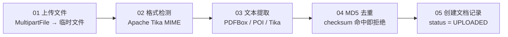
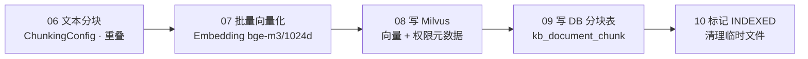
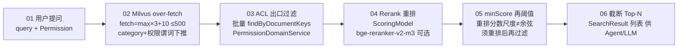
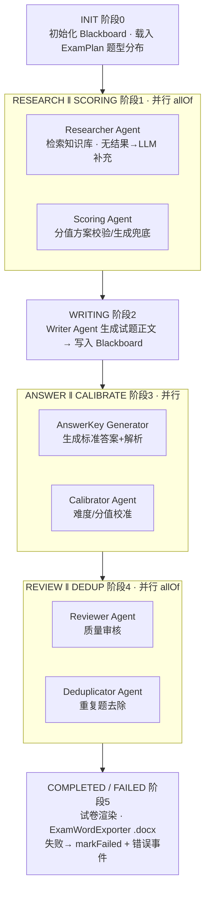
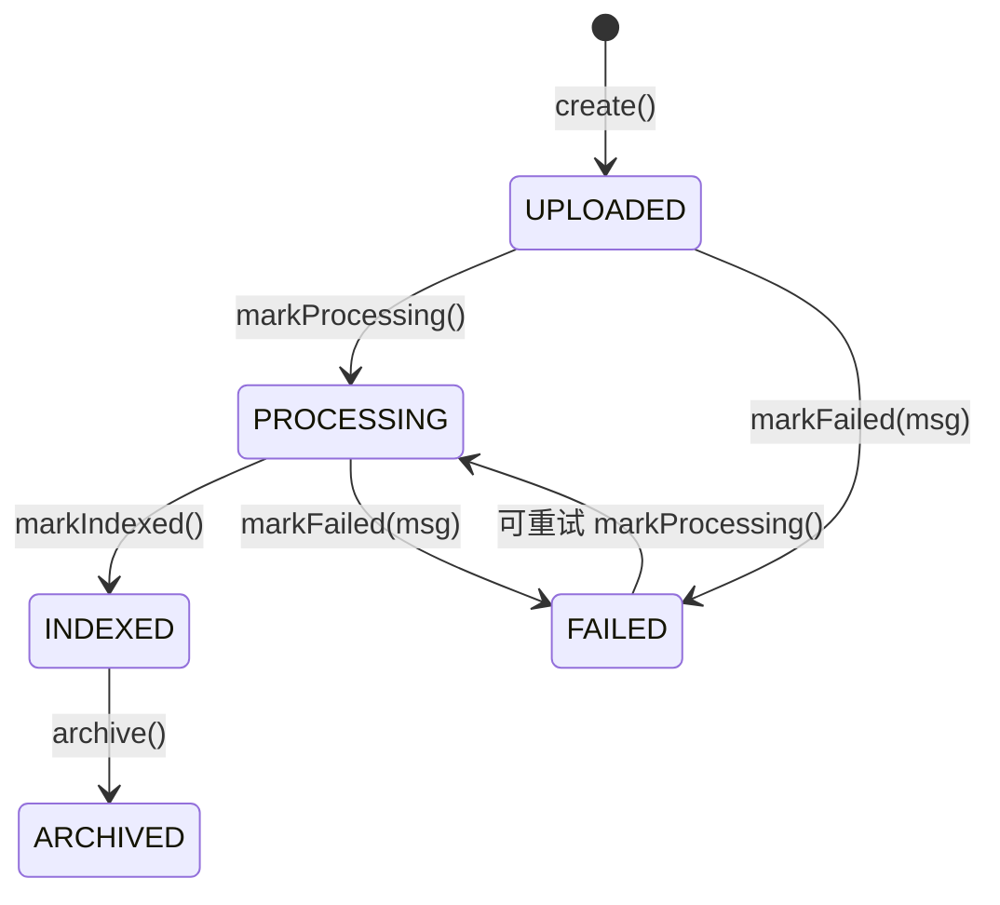
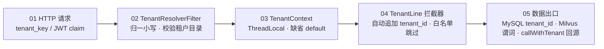
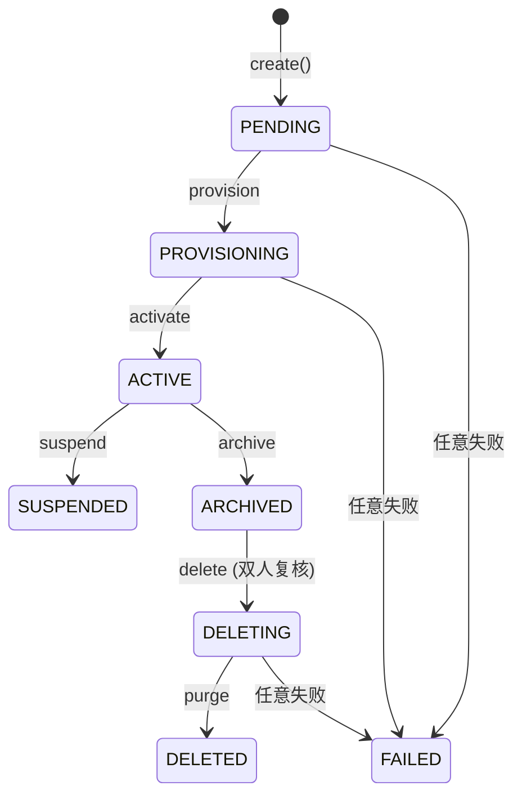
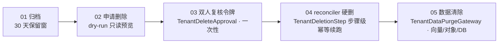

# Knowledge Repository — 系统架构蓝图

> RAG 知识库 + 多智能体出卷 + SaaS 多租户 · COLA 五层 · Spring Boot 3.4 / Java 21
>
> 本文件与 [architecture-diagram.html](architecture-diagram.html) 内容同源，为纯文本 / Mermaid 版本，便于在 Git diff、README 与不支持 HTML 的场景下查阅。
> 分层归属 / 依赖方向 / 对象转化等**架构规则**权威见 [architecture-decisions.md](architecture-decisions.md)；技术选型见 [tech-stack.md](tech-stack.md)。
> 维护：`@author mouhinU` · 最后同步 2026-10-13

## 目录

- [SHEET 00 · 概览](#sheet-00--概览)
- [FIG 1 · COLA 五层架构与模块依赖](#fig-1--cola-五层架构与模块依赖)
- [FIG 2 · 文档摄入（RAG Ingestion）流水线](#fig-2--文档摄入rag-ingestion流水线)
- [FIG 3 · 语义检索与 RAG 查询流程](#fig-3--语义检索与-rag-查询流程)
- [FIG 4 · 多智能体出卷流水线（Blackboard 黑板模式）](#fig-4--多智能体出卷流水线blackboard-黑板模式)
- [FIG 5 · Document 聚合根状态机](#fig-5--document-聚合根状态机)
- [FIG 6 · 运行时与部署拓扑](#fig-6--运行时与部署拓扑)
- [FIG 7 · SaaS 多租户隔离架构](#fig-7--saas-多租户隔离架构)
- [FIG 8 · 租户生命周期与配额计费](#fig-8--租户生命周期与配额计费)

---

## SHEET 00 · 概览

| 维度 | 取值 | 维度 | 取值 |
|---|---|---|---|
| Framework | Spring Boot 3.4.4 | Runtime | Java 21（虚拟线程） |
| RAG Engine | LangChain4j 1.0.1 | Vector Store | Milvus 2.5.4 |
| Persistence | MyBatis-Plus 3.5.17 + Flyway V35 | Database | H2 (dev) / MySQL (prod) |
| Arch Style | COLA 5-Module + SaaS 多租户 | Server Port | :8091 |
| Object Storage | MinIO SDK 8.5.17 / 本地 | Cache / Coord | Redis（pub/sub · lock · session） |
| Tenant Isolation | POOL (tenant_id) + SILO (kc_*) | Feature Gates | saas / platform / oidc / quota |

---

## FIG 1 · COLA 五层架构与模块依赖

依赖方向：`WEB → CLIENT ← APPLICATION → DOMAIN ← INFRASTRUCTURE`（Infrastructure 反向实现 Domain 定义的 Gateway 接口，即依赖倒置）。

| 层 | 物理模块 | 职责 | 关键构成（当前代码计数） |
|---|---|---|---|
| 适配层 (adapter) | `knowledge-web` | Controller / 安全配置 / 全局异常 / 管理台 SPA / SSE Store | 23 Controller · 4 Filter（TenantResolver · Admin/PlatformToken · HtmlCacheBuster）· 3 SSE ProgressStore |
| 契约层 (client) | `knowledge-client` | 对外 `*ServiceI` 接口 + Cmd/Qry/DTO/VO，仅被依赖不反向依赖 | 14 × ServiceI · 76 文件（Cmd/Qry/DTO/VO/Request/Response） |
| 应用层 (app) | `knowledge-application` | 用例编排 (Executor) / `@Transactional` / DTO↔领域转换，仅分发不含核心规则 | 14 × ServiceImpl · 107 Executor（15 特性包）· ExamGenerationSupport · AuthorizedSearchSupport · QuotaGuard |
| 领域层 (domain · 核心) | `knowledge-domain` | 聚合根 / 实体 / 值对象 / 领域服务 / Gateway 接口 / 领域事件 / TenantContext，不依赖 infra/app/web | 1 聚合根 (Document) · 19 实体 · 42 值对象 · 23 领域服务 · 42 Gateway 接口 · 4 领域事件 |
| 基础设施层 (infrastructure) | `knowledge-infrastructure` | GatewayImpl / DO / Mapper / 租户拦截器 / Milvus / Redis / MinIO / 解析策略 / LLM 韧性 / Agent 实现 | 27 GatewayImpl · 27 DO · 26 Mapper · KnowledgeTenantLineHandler · Milvus/Redis/MinIO 双驱动（Real + Noop）· 16 Agent |

要点：上层依赖下层；领域层保持纯净；client 仅被依赖不反向依赖；Infrastructure 实现 Domain 定义的 Gateway 接口（依赖倒置）。

---

## FIG 2 · 文档摄入（RAG Ingestion）流水线

`UPLOAD → DETECT → EXTRACT → DEDUP → PREVIEW → INDEX (CHUNK · EMBED · STORE)`

### 阶段 A — 上传与提取（uploadOnly / uploadAndProcess）

> 预览确认阶段：解析结果暂存于 `extractionCache`，用户确认后再触发索引。

### 阶段 B — 索引与向量化（indexDocumentAsync + SSE 进度）

**解析策略路由 · DocumentExtractionService**：PDF → PDFBox 按页（扫描型低文本密度告警）｜Word → POI 每 30 段一 section｜Excel → POI 按 Sheet 保留行列｜PPTX → POI 按幻灯片遍历形状｜其他 → Tika AutoDetectParser。文件大小上限 200MB · 临时文件必在 `finally` 清理 · 进度经 `IndexProgressCallback` 推送 SSE。

---

## FIG 3 · 语义检索与 RAG 查询流程

`QUERY → EMBED → MILVUS OVER-FETCH (CATEGORY + PERMISSION PREDICATE) → ACL EGRESS FILTER → RERANK → MINSCORE → TOP-N`

**权限模型 · RBAC + 文档级 ACL**

| 可见性 | 语义 |
|---|---|
| PUBLIC | 所有用户可见 |
| INTERNAL | 同部门可见 |
| RESTRICTED | 指定角色可见 |
| PRIVATE | 仅所有者可见 |

元数据写入 Milvus：`document_key · department_id · visibility · allowed_roles · owner_id · category · tenant_id`。`buildFilterExpression()` 据此生成检索过滤（category / tenant_id 以标量谓词下推 Milvus）；超级管理员绕过限制。ACL 出口按 `documentKey` 批量回表（`findByDocumentKeys`，SQL IN）避免 N+1；元数据缺失按最小权限拒绝（宁漏不越权）。

---

## FIG 4 · 多智能体出卷流水线（Blackboard 黑板模式）

`EXAM GENERATION · 7-STEP AGENT PIPELINE · SHARED BLACKBOARD + PARALLEL STAGES + SSE`

**Blackboard 共享状态机制**：各 Agent 实现 `domain.service.BlackboardAgent#execute(blackboard, callback)`，读写同一 `BlackboardState`；`CompletableFuture` + `agentExecutor` 线程池驱动并行；每阶段经 `BlackboardProgressCallback` → SSE `text/event-stream` 实时推送前端；前端先建 `EventSource` 再发 POST，`sessionId` 由前端生成。同模式复用：文章生成（Researcher → Writer → Reviewer，3 Agent 串行）· 题型分布方案（4 阶段 Agent）。

---

## FIG 5 · Document 聚合根状态机

状态转换前置校验由聚合根守护：`markProcessing` 仅接受 UPLOADED/FAILED；`markIndexed` 仅接受 PROCESSING；`archive` 仅接受 INDEXED。非法转换抛出带业务含义的异常。

---

## FIG 6 · 运行时与部署拓扑

`APPLICATION · DATA LAYER · DOCKER INFRA · AI MODEL ENDPOINTS`

| 应用进程 | 数据与存储 | AI 模型端点 |
|---|---|---|
| **knowledge-web (Fat Jar)** — :8091 · Spring MVC + SSE + 管理台 SPA | 关系库 — H2(内嵌) ↔ MySQL:3307 · Flyway V1–V35 | Embedding — bge-m3 (1024d) · Ollama / DashScope |
| Caddy 反向代理 + 2 副本 — docker-compose.scale.yml · 无状态水平扩展 | Milvus Standalone — :19530 · POOL `knowledge_chunks` / SILO `kc_{tenant}` | Chat LLM — DeepSeek · OpenAI 兼容协议 |
| 4 Servlet Filter — TenantResolver · Admin/PlatformToken · HtmlCacheBuster | MinIO 对象存储 + etcd — SDK 8.5.17 · 原文/图片 + Milvus 依赖 | Reranker — bge-reranker-v2-m3 · `/v1/rerank`（默认关闭） |
| GlobalExceptionHandler — 统一响应体 · 402/429/409 映射 | Redis (单机) — config pub/sub · 分布式锁 · 上传会话 | 超时 / 切换 — Ollama 300s · 其他 120s · `@ConditionalOnProperty` |

**deploy**：`bash deploy.sh` 生成镜像 tag `V{YYYYMMDD}{序号}`（**非** Flyway 版本号）· export/import 扁平化为单层 · 轮询 `docker inspect health=healthy` 后 curl 校验 · `restart` 不更新镜像须重跑 `deploy.sh` · Docker `TZ=Asia/Shanghai`。

**gates**：四道门控默认关闭即"零风险回退"——`knowledge.saas.enabled` · `saas.quota.enabled` · `platform.enabled` · `platform.oidc.enabled`（Redis 默认开）。

---

## FIG 7 · SaaS 多租户隔离架构

`TENANT CONTEXT PROPAGATION · POOL + SILO ISOLATION · PLATFORM ADMIN PLANE · THREE-TIER CONFIG · PER-TENANT LLM PROFILE`

### 租户上下文传播链（HTTP 入口 → SQL / 向量出口）

### 隔离模型 · POOL（现网默认）↔ SILO（Phase 3 门控）

| POOL · 共享库 + 行级隔离 | SILO · 独立集合隔离 |
|---|---|
| 共享表 + `tenant_id` 列（V24 补列 · V26 NOT NULL DEFAULT 1） | 独立集合 `kc_{tenantKey}`（SiloCollectionNaming 前缀 `kc_`） |
| Milvus `knowledge_chunks` 单集合 · JSON / 标量谓词下推过滤 | `MilvusSiloCollectionAdmin` 建 / drop / describe（+ Noop 双驱动） |
| `saas.enabled=false` → 恒 `default` · 拦截器短路 · 行为等价单租户 | `TenantSchemaRunner` `@Scheduled` 30min 巡检 · 失败隔离 · 审计 |

### 平台管理面 · 三级配置读取 · 租户级模型档案

| 平台管理面 (`/api/platform/**`) | 三级配置读取 | 租户级模型档案 |
|---|---|---|
| `PlatformTokenAuthFilter` — 独立 secret · 与租户令牌互不可用 | Tier1 租户 → Tier2 平台 → Tier3 内置（平台锚 `default`，复用 V23 种子租户） | `TenantLlmProfileResolver` — V31 `sys_tenant_llm_profile` |
| OIDC 企业 IdP（可选）— RS256 / JWKS 缓存 · 本地 JWT 不命中回退 | `ConfigCacheKey(tenantKey, configKey)` — 值对象分片 · `evictTenant` 不牵连平台 | `SecretCipher`（domain 端口）— `LocalSecretCipher` AES-256-GCM · 零新依赖 |
| Tenant · Billing · Limit · SchemaHealth — `PlatformAuditLog` 审计留痕 | Redis pub/sub 分布式失效 + TTL 300s 兜底 · 手工失效端点 | 密钥轮换 — 双人复核 · 令牌表模式 |

---

## FIG 8 · 租户生命周期与配额计费

`PROVISIONING STATE MACHINE · ARCHIVE & DELETE (双人复核) · QUOTA GUARD · USAGE METERING & BILLING`

### 租户状态机（Tenant 聚合）

### 归档与删除编排（P3-T5 Archive & Delete）

幂等键 UUID v4（S-5=A）· 超时由 Scheduler 恢复续跑 · 未发布 / 已作废态非法转换映射 409。

### 配额前置拦截 · 用量计量 · 计费导出（Phase 6）

| QuotaGuard 前置拦截 | 用量计量采集 | 套餐限额与计费 |
|---|---|---|
| 三策略 `BLOCK > THROTTLE > ALERT`（同时超额取最严） | `TenantUsageRecorder` — `@Primary` 装饰器自动采集 | `TenantPlanLimit` + `QuotaPolicy` — V33 `tenant_plan_limit` |
| `QuotaExceeded` → 402 · `ThrottleRequired` → 429 | `UsageCapturing` Chat / Embedding — `tokenUsage()` null 安全 | `PlatformLimitController` — GET / POST / DELETE CRUD |
| 6 CmdExe 集成（upload×3 · exam×2 · article×1） | `UsageMetric` 白名单 — CHAT/EMBEDDING_TOKENS · DOC_COUNT · STORAGE_BYTES（V32） | `PlatformBillingController` — CSV / JSON 导出 |

**gate**：`knowledge.saas.quota.enabled=false` 时 `QuotaGuard` 不装配、装饰器退化为 Noop，计量与拦截零副作用。
