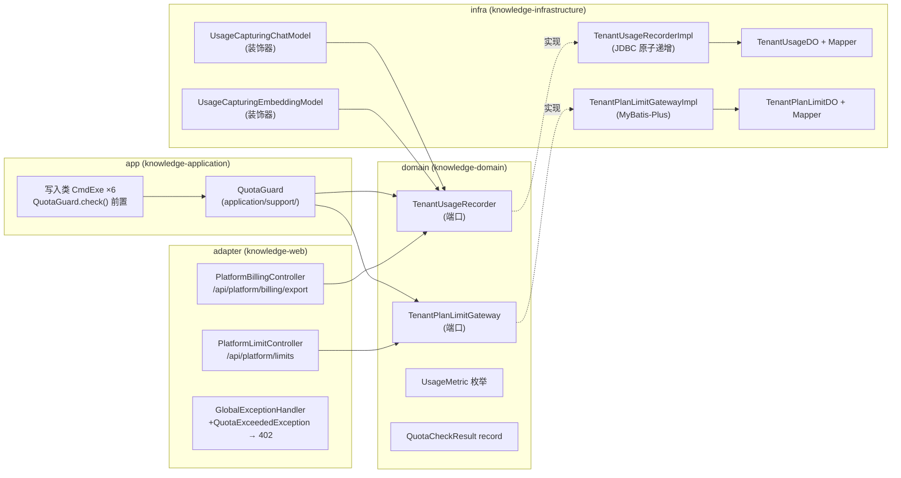
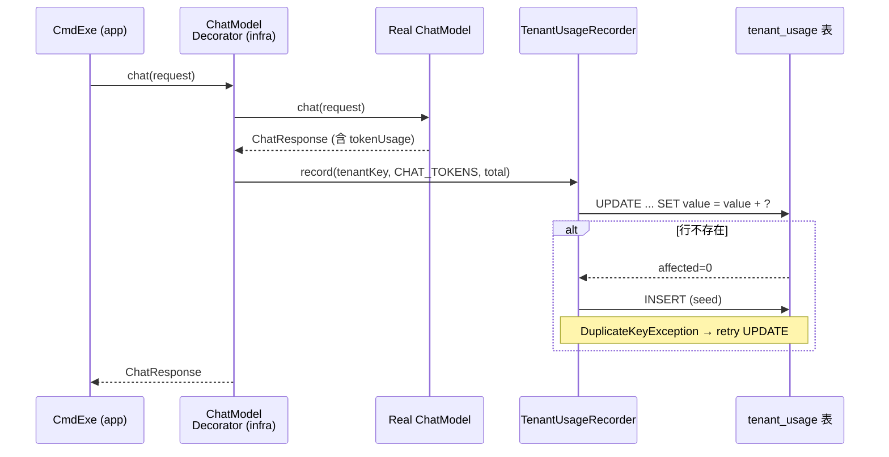

<!--
AGENTS-REFERENCE: ./AGENTS.md §0 红线 · docs/saas-phase6-go-checklist.md v0.1 · docs/saas-multi-tenant-execution-plan.md §8 · docs/saas-multi-tenant-proposal.md §4
-->

# SaaS 化改造 · Phase 6 详细设计（Detailed Design）

> 状态：**v0.1 起草 · 2026-10-12** · 配套门禁清单 [saas-phase6-go-checklist.md](saas-phase6-go-checklist.md) v0.1
> 权威：清单 §2 B / §3 S 已按推荐方案直接定案；备选方案与否决理由见各节"方案比选"段。
> 基线技术栈：Spring Boot 3.4 / Java 21 / MyBatis-Plus 3.5.17 / LangChain4j 1.0.1 / H2 + MySQL / Flyway。
> COLA 分层：adapter=`knowledge-web` · app=`knowledge-application` · client=`knowledge-client` · domain=
`knowledge-domain` · infra=`knowledge-infrastructure`。

---

## 1. 概述

### 1.1 Phase 6 范围

Phase 6 = 配额与计费（P6-T1~T4），把 SaaS 化改造从"技术隔离"推向"商业化运营"：

- **P6-T1** `tenant_usage` 计量表 + `TenantUsageRecorder` 端口 + infra 边界埋点
- **P6-T2** `tenant_plan_limit` 套餐限额表 + 平台端 CRUD
- **P6-T3** `QuotaGuard` 前置拦截（BLOCK / THROTTLE / ALERT 三策略）
- **P6-T4** `PlatformBillingController` 计费数据聚合导出（CSV / JSON）

### 1.2 退出条件

三策略端到端可用；tenant 维度不进 Prometheus 标签；数据可导出。

### 1.3 依赖（全部已交付）

P1-T7（`SystemConfigService`）· P2-T3（`EmbeddingStoreProvider`）· P4-T4（`TenantLlmProfileResolver` +
`sys_tenant_llm_profile`）· X-T2（`knowledge.saas.enabled` 门控）· Redis（P4-T1 引入）· `PlatformTokenAuthFilter`（P3-T1）。

### 1.4 门控

新增第三闸门 `knowledge.saas.quota.enabled=false`（默认关闭）。`saas.enabled=false` 级联关闭 quota 子系统——`QuotaGuard`
不装配、`PlatformBillingController` 不装配、计量采集不装配。

### 1.5 组件总览



---

## 2. P6-T1 · `tenant_usage` 计量表 + 采集

### 2.1 DDL

**MySQL**（`V32__create_tenant_usage.sql`，四段式第一段）：

```sql
CREATE TABLE tenant_usage (
    id          BIGINT AUTO_INCREMENT PRIMARY KEY,
    tenant_id   BIGINT       NOT NULL,
    metric      VARCHAR(64)  NOT NULL,
    period      DATE         NOT NULL COMMENT '当月1日',
    value       BIGINT       NOT NULL DEFAULT 0,
    create_time DATETIME     NOT NULL DEFAULT CURRENT_TIMESTAMP,
    update_time DATETIME     NOT NULL DEFAULT CURRENT_TIMESTAMP ON UPDATE CURRENT_TIMESTAMP,
    UNIQUE KEY uk_tenant_metric_period (tenant_id, metric, period)
) ENGINE=InnoDB DEFAULT CHARSET=utf8mb4 COLLATE=utf8mb4_unicode_ci;
```

**H2**（同文件，四段式 `-- H2` 注释段）：

```sql
-- H2
CREATE TABLE IF NOT EXISTS tenant_usage (
    id          BIGINT AUTO_INCREMENT PRIMARY KEY,
    tenant_id   BIGINT       NOT NULL,
    metric      VARCHAR(64)  NOT NULL,
    period      DATE         NOT NULL,
    value       BIGINT       NOT NULL DEFAULT 0,
    create_time DATETIME     NOT NULL DEFAULT CURRENT_TIMESTAMP,
    update_time DATETIME     NOT NULL DEFAULT CURRENT_TIMESTAMP
);
-- H2
CREATE UNIQUE INDEX IF NOT EXISTS uk_tenant_metric_period ON tenant_usage (tenant_id, metric, period);
```

**关键设计决策**：

- `period` = 当月 1 日（`DATE` 类型），按月聚合。每租户每月 ≤7 行（当前 metric 白名单 4 种，远期 7 种）。
- `value` = `BIGINT` 只增不减（计数器语义）。跨月重置通过"新月份首次 record → INSERT value=amount"实现，无需显式 reset。
- 唯一键 `(tenant_id, metric, period)` 保证幂等。
- **不**加入 `KnowledgeTenantLineHandler.IGNORE_TABLES`（白名单当前 8 张）——`tenant_usage` 有 `tenant_id` 列，
  `TenantLineInnerInterceptor` 自动追加 `WHERE tenant_id=?`，跨租户查询天然隔离。

### 2.2 `UsageMetric` 枚举（domain）

```java
package com.mouhin.knowledge.repository.domain.model.valueobject;

/**
 * 计量指标白名单。新增 metric 只需加枚举值 + 对应 infra 边界埋点。
 * 限额表 tenant_plan_limit.metric 与此枚举 1:1 对应。
 */
public enum UsageMetric {
    CHAT_TOKENS("chat_tokens"),
    EMBEDDING_TOKENS("embedding_tokens"),
    DOC_COUNT("doc_count"),
    STORAGE_BYTES("storage_bytes");

    private final String code;
    UsageMetric(String code) { this.code = code; }
    public String code() { return code; }

    public static UsageMetric fromCode(String code) {
        for (UsageMetric m : values()) {
            if (m.code.equals(code)) return m;
        }
        throw new IllegalArgumentException("Unknown metric: " + code);
    }
}
```

Phase 6 首批 4 种即时计数 metric。`exam_count` / `article_count` 随业务模块埋点就绪后补（只需加枚举值 + 埋点，无限额行 =
无约束）。`mau_students` 需独立聚合任务，延后。

### 2.3 `TenantUsageRecorder` 端口（domain）

```java
package com.mouhin.knowledge.repository.domain.gateway;

import com.mouhin.knowledge.repository.domain.model.valueobject.UsageMetric;
import java.time.LocalDate;

/**
 * 计量采集端口。计数器语义：record() 只增不减，采集失败仅记 WARN 不阻塞业务。
 * 实现方须保证并发安全（同一租户同一 metric 可能多线程并发调用）。
 */
public interface TenantUsageRecorder {

    /**
     * 原子递增。首次调用（无现有行）时自动 seed。
     * @param tenantKey 归一化租户键（小写）
     * @param metric    指标枚举
     * @param amount    增量（≥0，负值静默忽略）
     */
    void record(String tenantKey, UsageMetric metric, long amount);

    /**
     * 查询指定租户当月用量。无记录返回 0。
     * @param tenantKey 归一化租户键
     * @param metric    指标枚举
     * @param period    查询周期（通常为当月 1 日）
     */
    long getCurrentUsage(String tenantKey, UsageMetric metric, LocalDate period);
}
```

### 2.4 Infra 实现

**`TenantUsageDO`**：

```java
@Getter @Setter
@TableName("tenant_usage")
public class TenantUsageDO {
    @TableId(type = IdType.AUTO)
    private Long id;
    private Long tenantId;
    private String metric;
    private LocalDate period;
    private Long value;
    private LocalDateTime createTime;
    private LocalDateTime updateTime;
}
```

**`TenantUsageMapper`**：

```java
@Mapper
public interface TenantUsageMapper extends BaseMapper<TenantUsageDO> {

    /** 原子递增，返回受影响行数。0 = 行不存在需 seed。 */
    @Update("UPDATE tenant_usage SET value = value + #{amount}, update_time = NOW() "
          + "WHERE tenant_id = #{tenantId} AND metric = #{metric} AND period = #{period}")
    int atomicIncrement(@Param("tenantId") long tenantId,
                        @Param("metric") String metric,
                        @Param("period") LocalDate period,
                        @Param("amount") long amount);
}
```

**`TenantUsageRecorderImpl`**：

```java
@Repository
@Slf4j
public class TenantUsageRecorderImpl implements TenantUsageRecorder {

    private final TenantUsageMapper mapper;
    private final TenantIdResolver tenantIdResolver;

    public TenantUsageRecorderImpl(TenantUsageMapper mapper,
                                   TenantIdResolver tenantIdResolver) {
        this.mapper = mapper;
        this.tenantIdResolver = tenantIdResolver;
    }

    @Override
    public void record(String tenantKey, UsageMetric metric, long amount) {
        if (amount <= 0) return;
        try {
            long tenantId = tenantIdResolver.resolve(tenantKey);
            LocalDate period = currentPeriod();
            int affected = mapper.atomicIncrement(tenantId, metric.code(), period, amount);
            if (affected == 0) {
                seedAndRetry(tenantId, metric, period, amount);
            }
        } catch (Exception e) {
            log.warn("[usage] record failed tenantKey={} metric={} amount={}: {}",
                     tenantKey, metric, amount, e.getMessage());
        }
    }

    @Override
    public long getCurrentUsage(String tenantKey, UsageMetric metric, LocalDate period) {
        long tenantId = tenantIdResolver.resolve(tenantKey);
        LambdaQueryWrapper<TenantUsageDO> wrapper = new LambdaQueryWrapper<>();
        wrapper.eq(TenantUsageDO::getTenantId, tenantId)
               .eq(TenantUsageDO::getMetric, metric.code())
               .eq(TenantUsageDO::getPeriod, period);
        TenantUsageDO row = mapper.selectOne(wrapper);
        return row != null ? row.getValue() : 0L;
    }

    /** 首次 seed：INSERT ... 唯一键冲突则 retry UPDATE。 */
    private void seedAndRetry(long tenantId, UsageMetric metric, LocalDate period, long amount) {
        try {
            TenantUsageDO seed = new TenantUsageDO();
            seed.setTenantId(tenantId);
            seed.setMetric(metric.code());
            seed.setPeriod(period);
            seed.setValue(amount);
            seed.setCreateTime(LocalDateTime.now());
            seed.setUpdateTime(LocalDateTime.now());
            mapper.insert(seed);
        } catch (DuplicateKeyException dup) {
            // 并发 seed → 退化为 UPDATE
            mapper.atomicIncrement(tenantId, metric.code(), period, amount);
        }
    }

    private static LocalDate currentPeriod() {
        LocalDate now = LocalDate.now();
        return now.withDayOfMonth(1);
    }
}
```

**`NoopTenantUsageRecorder`**（`saas.enabled=false` 或 `quota.enabled=false` 时装配）：

```java
@Component
@ConditionalOnProperty(name = "knowledge.saas.quota.enabled", havingValue = "false", matchIfMissing = true)
@Slf4j
public class NoopTenantUsageRecorder implements TenantUsageRecorder {
    @Override
    public void record(String tenantKey, UsageMetric metric, long amount) {
        // no-op
    }
    @Override
    public long getCurrentUsage(String tenantKey, UsageMetric metric, LocalDate period) {
        return 0L;
    }
}
```

### 2.5 LLM 调用点埋点——装饰器模式

**核心思路**：在 infra 层用装饰器包装 `ChatModel` / `EmbeddingModel` bean，自动从 `ChatResponse.metadata().tokenUsage()`
提取 token 消耗并调 `TenantUsageRecorder.record()`。app 层 CmdExe 零改动。

**`UsageCapturingChatModelDecorator`**：

```java
package com.mouhin.knowledge.repository.infrastructure.llm;

@Component
@Primary
@ConditionalOnProperty(name = "knowledge.saas.quota.enabled", havingValue = "true")
@Slf4j
public class UsageCapturingChatModelDecorator implements ChatModel {

    private final ChatModel delegate;
    private final TenantUsageRecorder usageRecorder;

    public UsageCapturingChatModelDecorator(@Qualifier("delegateChatModel") ChatModel delegate,
                                            TenantUsageRecorder usageRecorder) {
        this.delegate = delegate;
        this.usageRecorder = usageRecorder;
    }

    @Override
    public ChatResponse chat(ChatRequest request) {
        ChatResponse response = delegate.chat(request);
        captureUsage(response);
        return response;
    }

    private void captureUsage(ChatResponse response) {
        try {
            if (response == null || response.metadata() == null) return;
            var tokenUsage = response.metadata().tokenUsage();
            if (tokenUsage == null) return;
            String tenantKey = TenantContext.getOrDefault();
            int total = tokenUsage.inputTokenCount() + tokenUsage.outputTokenCount();
            if (total > 0) {
                usageRecorder.record(tenantKey, UsageMetric.CHAT_TOKENS, total);
            }
        } catch (Exception e) {
            log.warn("[usage] chat token capture failed: {}", e.getMessage());
        }
    }
}
```

**`UsageCapturingEmbeddingModelDecorator`**：同理，从 `Response<List<Embedding>>.metadata().tokenUsage()` 提取 →
`record(tenantKey, EMBEDDING_TOKENS, total)`。

**流式调用（`StreamingChatGateway`）缺口**：当前 `streamCompletion()` 返 `String`，token usage 在 SSE 解析中丢失。Phase 6
不修改流式接口（改动面大），流式调用的 token 消耗**暂不计入**。在 `BlackboardAgentStreamer` /
`ExamGenerationSupport.validatePlanWithLlm` 等流式调用点留 `// TODO P6-T1: streaming usage capture` 标记，后续可通过修改
`StreamingChatGateway` 返回 `StreamResult(text, usage)` 补全。

**文件落库埋点**：在 `UploadOnlyCmdExe` / `UploadFromFileCmdExe` / `UploadAndProcessCmdExe` 的 `execute()` 成功路径末尾调用
`usageRecorder.record(tenantKey, DOC_COUNT, 1)` + `record(tenantKey, STORAGE_BYTES, fileSize)`。

### 2.6 时序图 · 计量采集



---

## 3. P6-T2 · `tenant_plan_limit` 套餐限额表 + CRUD

### 3.1 DDL

**MySQL**（`V33__tenant_plan_limit.sql`）：

```sql
CREATE TABLE tenant_plan_limit (
    id          BIGINT AUTO_INCREMENT PRIMARY KEY,
    tenant_id   BIGINT       NOT NULL,
    metric      VARCHAR(64)  NOT NULL,
    quota       BIGINT       NOT NULL COMMENT '限额绝对值，-1=无限',
    policy      VARCHAR(16)  NOT NULL DEFAULT 'ALERT' COMMENT 'BLOCK|THROTTLE|ALERT',
    create_time DATETIME     NOT NULL DEFAULT CURRENT_TIMESTAMP,
    update_time DATETIME     NOT NULL DEFAULT CURRENT_TIMESTAMP ON UPDATE CURRENT_TIMESTAMP,
    UNIQUE KEY uk_tenant_metric (tenant_id, metric)
) ENGINE=InnoDB DEFAULT CHARSET=utf8mb4 COLLATE=utf8mb4_unicode_ci;
```

**H2**（同文件，四段式 `-- H2` 注释段）：

```sql
-- H2
CREATE TABLE IF NOT EXISTS tenant_plan_limit (
    id          BIGINT AUTO_INCREMENT PRIMARY KEY,
    tenant_id   BIGINT       NOT NULL,
    metric      VARCHAR(64)  NOT NULL,
    quota       BIGINT       NOT NULL,
    policy      VARCHAR(16)  NOT NULL DEFAULT 'ALERT',
    create_time DATETIME     NOT NULL DEFAULT CURRENT_TIMESTAMP,
    update_time DATETIME     NOT NULL DEFAULT CURRENT_TIMESTAMP
);
-- H2
CREATE UNIQUE INDEX IF NOT EXISTS uk_tenant_metric ON tenant_plan_limit (tenant_id, metric);
```

**关键设计决策**：

- `quota BIGINT`，`-1` 表示无限额（语义清晰，避免 NULL 判断）。
- `policy` 默认 `ALERT`（记录不阻断），平台管理员可按 metric 调整为 `BLOCK` / `THROTTLE`。
- 唯一键 `(tenant_id, metric)`——每租户每 metric 一条限额。无记录 = 无约束。
- 按月重置：`quota` 是每月配额，每月 1 号自动归零（由 `tenant_usage.period` 新月份无记录实现，无需显式 reset 限额表）。
- 不加入 `IGNORE_TABLES`——自动租户隔离。

### 3.2 `TenantPlanLimitGateway` 端口（domain）

```java
package com.mouhin.knowledge.repository.domain.gateway;

import com.mouhin.knowledge.repository.domain.model.valueobject.UsageMetric;
import java.util.List;
import java.util.Optional;

/**
 * 套餐限额仓储接口。平台管理员 CRUD，租户侧只读。
 */
public interface TenantPlanLimitGateway {

    /** 查询指定租户的全部限额配置。 */
    List<TenantPlanLimit> findByTenantKey(String tenantKey);

    /** 查询指定租户指定 metric 的限额。无记录返回 empty（= 无约束）。 */
    Optional<TenantPlanLimit> findByTenantKeyAndMetric(String tenantKey, UsageMetric metric);

    /** 新增或更新限额（upsert 语义）。 */
    void saveOrUpdate(String tenantKey, TenantPlanLimit limit);

    /** 删除指定租户指定 metric 的限额。 */
    void delete(String tenantKey, UsageMetric metric);
}
```

**`TenantPlanLimit` 值对象**（domain）：

```java
public record TenantPlanLimit(
    UsageMetric metric,
    long quota,          // -1 = 无限
    QuotaPolicy policy   // BLOCK / THROTTLE / ALERT
) {
    public boolean isUnlimited() { return quota < 0; }
}
```

**`QuotaPolicy` 枚举**（domain）：

```java
public enum QuotaPolicy {
    BLOCK, THROTTLE, ALERT
}
```

### 3.3 平台端 CRUD API

新增 `PlatformLimitController`（`@ConditionalOnProperty(name = "knowledge.platform.enabled", havingValue = "true")`）：

| 方法       | 路径                                          | 描述            | 请求体                                  | 响应                        |
|----------|---------------------------------------------|---------------|--------------------------------------|---------------------------|
| `GET`    | `/api/platform/limits?tenant={tenantKey}`   | 列出指定租户全部限额    | —                                    | `List<TenantPlanLimitVO>` |
| `POST`   | `/api/platform/limits`                      | 新增或更新限额       | `{tenantKey, metric, quota, policy}` | `TenantPlanLimitVO`       |
| `DELETE` | `/api/platform/limits/{tenantKey}/{metric}` | 删除限额（= 恢复无约束） | —                                    | `{message: "deleted"}`    |

权限：走 `PlatformTokenAuthFilter`（平台管理员），与 `PlatformTenantController` 同安全域。

---

## 4. P6-T3 · `QuotaGuard` 前置拦截

### 4.1 设计定案

| 维度          | 定案                                                                                |
|-------------|-----------------------------------------------------------------------------------|
| 所属层         | app（`application/support/`），非 domain                                              |
| 装配条件        | `@ConditionalOnProperty(name="knowledge.saas.quota.enabled", havingValue="true")` |
| 级联门控        | `saas.enabled=false` → `quota.enabled` 强制不生效（文档约束，不硬编码级联）                         |
| 检查时机        | CmdExe `execute()` **最前面**，事务外                                                    |
| 多 metric 超额 | 取最严策略：BLOCK > THROTTLE > ALERT                                                    |
| BLOCK 响应    | HTTP 402 + `QUOTA_EXCEEDED` errorCode + 辅助字段                                      |
| THROTTLE 响应 | HTTP 429 + `Retry-After: 60` header                                               |
| ALERT 行为    | `log.warn` 记录，不阻断                                                                 |

### 4.2 `QuotaGuard`（app）

```java
package com.mouhin.knowledge.repository.application.support;

@Component
@ConditionalOnProperty(name = "knowledge.saas.quota.enabled", havingValue = "true")
@Slf4j
public class QuotaGuard {

    private final TenantUsageRecorder usageRecorder;
    private final TenantPlanLimitGateway limitGateway;

    public QuotaGuard(TenantUsageRecorder usageRecorder,
                      TenantPlanLimitGateway limitGateway) {
        this.usageRecorder = usageRecorder;
        this.limitGateway = limitGateway;
    }

    /**
     * 前置检查所有已配置 metric 的配额。返回最严策略结果。
     * @throws QuotaExceededException 当最严策略为 BLOCK 时
     * @throws ThrottleRequiredException 当最严策略为 THROTTLE 时
     */
    public void check(String tenantKey) {
        if (tenantKey == null || tenantKey.isBlank()) {
            throw new IllegalArgumentException("tenantKey required for quota check");
        }
        LocalDate period = LocalDate.now().withDayOfMonth(1);
        List<TenantPlanLimit> limits = limitGateway.findByTenantKey(tenantKey);
        if (limits.isEmpty()) return; // 无限额 = 无约束

        QuotaCheckResult worst = null;
        for (TenantPlanLimit limit : limits) {
            if (limit.isUnlimited()) continue;
            long current = usageRecorder.getCurrentUsage(tenantKey, limit.metric(), period);
            QuotaCheckResult result = evaluate(tenantKey, limit, current);
            worst = QuotaCheckResult.merge(worst, result);
        }
        if (worst != null && worst.action() != QuotaAction.PASS) {
            handleViolation(worst);
        }
    }

    private QuotaCheckResult evaluate(String tenantKey, TenantPlanLimit limit, long current) {
        if (current >= limit.quota()) {
            return new QuotaCheckResult(
                QuotaAction.fromPolicy(limit.policy()),
                tenantKey, limit.metric(), limit.quota(), current);
        }
        return new QuotaCheckResult(QuotaAction.PASS, tenantKey, limit.metric(), limit.quota(), current);
    }

    private void handleViolation(QuotaCheckResult result) {
        switch (result.action()) {
            case BLOCK -> throw new QuotaExceededException(result);
            case THROTTLE -> throw new ThrottleRequiredException(result);
            case ALERT -> log.warn("[quota] ALERT tenant={} metric={} quota={} current={}",
                                   result.tenantKey(), result.metric(),
                                   result.quota(), result.currentUsage());
            default -> { /* PASS, no-op */ }
        }
    }
}
```

### 4.3 异常类与值对象

```java
// domain/model/valueobject/QuotaAction.java
public enum QuotaAction { PASS, BLOCK, THROTTLE, ALERT }

// domain/model/valueobject/QuotaCheckResult.java（含 tenantKey 供日志与响应使用）
public record QuotaCheckResult(
    QuotaAction action,
    String tenantKey,
    UsageMetric metric,
    long quota,
    long currentUsage
) {
    private static final QuotaAction[] SEVERITY = {QuotaAction.PASS, QuotaAction.ALERT, QuotaAction.THROTTLE, QuotaAction.BLOCK};

    public static QuotaCheckResult merge(QuotaCheckResult a, QuotaCheckResult b) {
        if (a == null) return b;
        if (b == null) return a;
        return severityOf(a.action()) >= severityOf(b.action()) ? a : b;
    }
    private static int severityOf(QuotaAction action) {
        return java.util.Arrays.asList(SEVERITY).indexOf(action);
    }
}
```

```java
// domain/exception/QuotaExceededException.java（domain 层，app/adapter 均可引用）
public class QuotaExceededException extends RuntimeException {
    private final QuotaCheckResult result;
    public QuotaExceededException(QuotaCheckResult result) {
        super("Quota exceeded: " + result.metric().code());
        this.result = result;
    }
    public QuotaCheckResult result() { return result; }
}

// domain/exception/ThrottleRequiredException.java（domain 层）
public class ThrottleRequiredException extends RuntimeException {
    private final QuotaCheckResult result;
    public ThrottleRequiredException(QuotaCheckResult result) {
        super("Throttle required: " + result.metric().code());
        this.result = result;
    }
    public QuotaCheckResult result() { return result; }
}
```

### 4.4 `GlobalExceptionHandler` 扩展

新增两个 handler：

```java
@ExceptionHandler(QuotaExceededException.class)
public ResponseEntity<Map<String, Object>> handleQuotaExceeded(QuotaExceededException ex) {
    QuotaCheckResult r = ex.result();
    Map<String, Object> body = new LinkedHashMap<>();
    body.put("errorCode", "QUOTA_EXCEEDED");
    body.put("errorMessage", "配额已用尽：" + r.metric().code());
    body.put("metric", r.metric().code());
    body.put("quota", r.quota());
    body.put("currentUsage", r.currentUsage());
    body.put("timestamp", Instant.now().toString());
    return ResponseEntity.status(402).body(body);
}

@ExceptionHandler(ThrottleRequiredException.class)
public ResponseEntity<Map<String, Object>> handleThrottle(ThrottleRequiredException ex,
                                                          HttpServletResponse response) {
    response.setHeader("Retry-After", "60");
    QuotaCheckResult r = ex.result();
    Map<String, Object> body = new LinkedHashMap<>();
    body.put("errorCode", "THROTTLE_REQUIRED");
    body.put("errorMessage", "请求过于频繁，请稍后重试");
    body.put("metric", r.metric().code());
    body.put("timestamp", Instant.now().toString());
    return ResponseEntity.status(429).body(body);
}
```

### 4.5 CmdExe 集成模式

Tier 1 共 6 个 CmdExe 需集成 `QuotaGuard`。模式统一：构造器注入 `QuotaGuard`（`@Autowired(required = false)` 兼容关闭态），
`execute()` 第一行调用 `check()`。

```java
// 示例：UploadOnlyCmdExe
@Component
public class UploadOnlyCmdExe {

    private final QuotaGuard quotaGuard; // null when quota.enabled=false
    // ... other dependencies

    public UploadOnlyCmdExe(@Autowired(required = false) QuotaGuard quotaGuard,
                            /* ... */ ) {
        this.quotaGuard = quotaGuard;
    }

    public XxxVO execute(UploadCmd cmd) {
        if (quotaGuard != null) {
            quotaGuard.check(TenantContext.getOrDefault());
        }
        // ... 原有业务逻辑
    }
}
```

**Tier 1 集成清单**：

| CmdExe                       | guarded metric               | 说明        |
|------------------------------|------------------------------|-----------|
| `UploadOnlyCmdExe`           | `DOC_COUNT`, `STORAGE_BYTES` | 主上传路径     |
| `UploadAndProcessCmdExe`     | `DOC_COUNT`, `STORAGE_BYTES` | 上传+处理一体化  |
| `UploadFromFileCmdExe`       | `DOC_COUNT`, `STORAGE_BYTES` | 分片上传完成    |
| `GenerateExamSyncCmdExe`     | `CHAT_TOKENS`                | 同步出卷      |
| `GenerateExamAsyncCmdExe`    | `CHAT_TOKENS`                | 异步出卷（SSE） |
| `GenerateArticleAsyncCmdExe` | `CHAT_TOKENS`                | 异步文章生成    |

---

## 5. P6-T4 · `PlatformBillingController` 计费导出

### 5.1 API 契约

| 方法    | 路径                                                                                   | 描述   |
|-------|--------------------------------------------------------------------------------------|------|
| `GET` | `/api/platform/billing/export?from=2026-01&to=2026-10&tenant={tenantKey}&format=csv` | 聚合导出 |

**参数**：

| 参数       | 必填 | 说明                  |
|----------|----|---------------------|
| `from`   | 否  | 起始月份 `yyyy-MM`，默认当月 |
| `to`     | 否  | 结束月份 `yyyy-MM`，默认当月 |
| `tenant` | 否  | 租户键，不传 = 全部租户       |
| `format` | 否  | `csv`（默认）/ `json`   |

**权限**：`PlatformTokenAuthFilter`（平台管理员）。

**响应**：

- CSV：`Content-Type: text/csv; charset=UTF-8`，`Content-Disposition: attachment; filename=billing-{from}-to-{to}.csv`
- JSON：`Content-Type: application/json`

**CSV 格式**：

```csv
tenant_key,tenant_name,period,metric,quota,current_usage,utilization_pct
acme,ACME Corp,2026-10,chat_tokens,1000000,456789,45.68
acme,ACME Corp,2026-10,embedding_tokens,500000,123456,24.69
acme,ACME Corp,2026-10,doc_count,1000,42,4.20
acme,ACME Corp,2026-10,storage_bytes,10737418240,5368709120,50.00
globex,Globex Inc,2026-10,chat_tokens,-1,78901,,
```

`quota=-1` 表示无限额，`utilization_pct` 为空。

### 5.2 实现

```java
@RestController
@RequestMapping("/api/platform/billing")
@ConditionalOnProperty(name = "knowledge.platform.enabled", havingValue = "true")
@Slf4j
public class PlatformBillingController {

    private final TenantUsageRecorder usageRecorder;
    private final TenantPlanLimitGateway limitGateway;
    private final TenantGateway tenantGateway;

    // ... constructor

    @GetMapping("/export")
    public void export(@RequestParam(required = false) String from,
                       @RequestParam(required = false) String to,
                       @RequestParam(required = false) String tenant,
                       @RequestParam(defaultValue = "csv") String format,
                       HttpServletResponse response) throws IOException {
        LocalDate fromPeriod = parseMonth(from, LocalDate.now().withDayOfMonth(1));
        LocalDate toPeriod = parseMonth(to, fromPeriod);
        List<BillingRow> rows = aggregateBilling(fromPeriod, toPeriod, tenant);

        if ("json".equalsIgnoreCase(format)) {
            response.setContentType("application/json; charset=UTF-8");
            writeJson(rows, response.getWriter());
        } else {
            response.setContentType("text/csv; charset=UTF-8");
            response.setHeader("Content-Disposition",
                "attachment; filename=billing-" + from + "-to-" + to + ".csv");
            writeCsv(rows, response.getWriter());
        }
    }
}
```

`aggregateBilling` 逻辑：遍历租户 → 遍历月份 → 遍历 metric → 查 `tenant_usage` + 查 `tenant_plan_limit` → 组装
`BillingRow`。

---

## 6. 配置项汇总

`application.yml` 新增段：

```yaml
knowledge:
  saas:
    quota:
      enabled: ${KNOWLEDGE_SAAS_QUOTA_ENABLED:false}
```

| 配置项                            | 环境变量                           | 默认值     | 说明                                                                                                            |
|--------------------------------|--------------------------------|---------|---------------------------------------------------------------------------------------------------------------|
| `knowledge.saas.quota.enabled` | `KNOWLEDGE_SAAS_QUOTA_ENABLED` | `false` | 配额子系统总开关。关闭时 `QuotaGuard` / `UsageCapturingChatModelDecorator` / `UsageCapturingEmbeddingModelDecorator` 均不装配 |

三闸门关系：`saas.enabled=false` → 整个 SaaS 化改造关闭（含 quota）。`saas.enabled=true` + `quota.enabled=false` → SaaS
隔离生效但配额不采集不拦截。`saas.enabled=true` + `quota.enabled=true` → 全量生效。

---

## 7. 迁移策略

### 7.1 版本号

- `V32__create_tenant_usage.sql`（P6-T1）
- `V33__tenant_plan_limit.sql`（P6-T2）

占位号，开工时若被其他 Phase 抢先则顺延。

### 7.2 FlywayMigrationSmokeTest 同步

四处同步更新：

1. `EXPECTED_MIGRATION_COUNT`：31 → 33
2. `@DisplayName` 版本区间：`V1-V31` → `V1-V33`
3. 最终版本断言：`"31"` → `"33"`
4. 抽查：V32 表 `tenant_usage` 列 `metric` / `period` / `value`；V33 表 `tenant_plan_limit` 列 `quota` / `policy`

### 7.3 IGNORE_TABLES 白名单

`tenant_usage` 和 `tenant_plan_limit` 均**不**加入白名单——有 `tenant_id` 列，自动租户隔离。白名单维持 8 张不变。

---

## 8. 测试策略

### 8.1 单元测试

| 测试类                                    | 覆盖                                                                          | 用例数 |
|----------------------------------------|-----------------------------------------------------------------------------|-----|
| `TenantUsageRecorderImplTest`          | 原子递增 / seed / 并发安全 / 负值忽略 / 采集失败不抛异常                                        | 5   |
| `QuotaGuardTest`                       | BLOCK 抛异常 / THROTTLE 抛异常 / ALERT 仅记录 / 无限额放行 / 多 metric 取最严 / `quota=-1` 无限 | 6   |
| `UsageCapturingChatModelDecoratorTest` | token 提取 + record 调用 / 无 tokenUsage 静默跳过 / 异常不传播                            | 3   |

### 8.2 集成测试

| 测试类                            | Tag                | 覆盖                                                          | 用例数 |
|--------------------------------|--------------------|-------------------------------------------------------------|-----|
| `QuotaGuardEndToEndTest`       | `tenant-isolation` | BLOCK 阻断后不影响其他租户 / THROTTLE 返 429 + Retry-After / ALERT 不阻断 | 3   |
| `BillingExportIntegrationTest` | —                  | CSV 导出格式正确 / JSON 导出格式正确 / 权限校验（非平台管理员 401）                 | 3   |
| `TenantUsageMigrationTest`     | —                  | H2 原生 SQL V32/V33 表结构验证                                     | 2   |

### 8.3 Flyway 冒烟

`FlywayMigrationSmokeTest` 四处同步（§7.2），V32/V33 抽查。

---

## 9. 回退计划

| 层级  | 回退手段                                                                    |
|-----|-------------------------------------------------------------------------|
| 总开关 | `knowledge.saas.quota.enabled=false` → QuotaGuard / 装饰器 / 采集全部不装配，业务零影响 |
| 数据  | `tenant_usage` / `tenant_plan_limit` 为独立表，DROP 不影响业务表。迁移提供配对 undo       |
| 行为  | `saas.enabled=false` 级联关闭整个 SaaS 子系统（含 quota），退回单租户行为                   |

---

## 10. 文件清单（预估）

| 层         | 新增                                                                                                                                                                                                                                                          | 修改                                                                                                                                                                         |
|-----------|-------------------------------------------------------------------------------------------------------------------------------------------------------------------------------------------------------------------------------------------------------------|----------------------------------------------------------------------------------------------------------------------------------------------------------------------------|
| domain    | `UsageMetric` 枚举 · `QuotaPolicy` 枚举 · `QuotaAction` 枚举 · `QuotaCheckResult` record · `TenantPlanLimit` record · `TenantUsageRecorder` 端口 · `TenantPlanLimitGateway` 端口 · `QuotaExceededException` · `ThrottleRequiredException`                             | —                                                                                                                                                                          |
| infra     | `TenantUsageDO` · `TenantUsageMapper` · `TenantUsageRecorderImpl` · `NoopTenantUsageRecorder` · `TenantPlanLimitDO` · `TenantPlanLimitMapper` · `TenantPlanLimitGatewayImpl` · `UsageCapturingChatModelDecorator` · `UsageCapturingEmbeddingModelDecorator` | `ChatModelConfig`（`@Qualifier("delegateChatModel")`）· `EmbeddingModelConfig`（同理）                                                                                           |
| app       | `QuotaGuard`                                                                                                                                                                                                                                                | `UploadOnlyCmdExe` · `UploadAndProcessCmdExe` · `UploadFromFileCmdExe` · `GenerateExamSyncCmdExe` · `GenerateExamAsyncCmdExe` · `GenerateArticleAsyncCmdExe`（各加 1 行 check） |
| adapter   | `PlatformBillingController` · `PlatformLimitController` · `TenantPlanLimitVO`                                                                                                                                                                               | `GlobalExceptionHandler`（+2 handler）                                                                                                                                       |
| migration | `V32__create_tenant_usage.sql` · `V33__tenant_plan_limit.sql`                                                                                                                                                                                               | —                                                                                                                                                                          |
| config    | —                                                                                                                                                                                                                                                           | `application.yml`（+`quota.enabled`）                                                                                                                                        |
| test      | `TenantUsageRecorderImplTest` · `QuotaGuardTest` · `UsageCapturingChatModelDecoratorTest` · `QuotaGuardEndToEndTest` · `BillingExportIntegrationTest` · `TenantUsageMigrationTest`                                                                          | `FlywayMigrationSmokeTest`（四处同步）                                                                                                                                           |

**预估新增**：~25 文件 · ~1500 行 · 修改 ~10 文件 · ~50 行。

---

**文档版本 v0.1 · 2026-10-12 起草 · 配套清单 v0.1 待会审**
